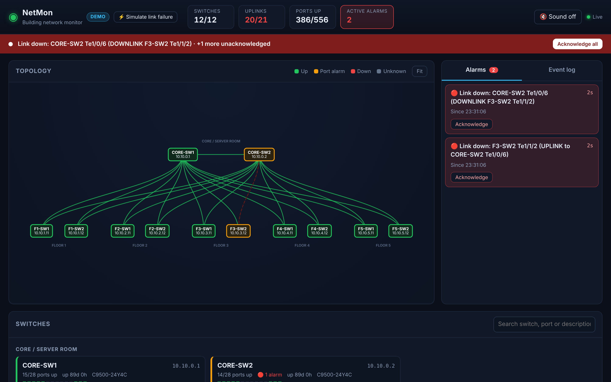
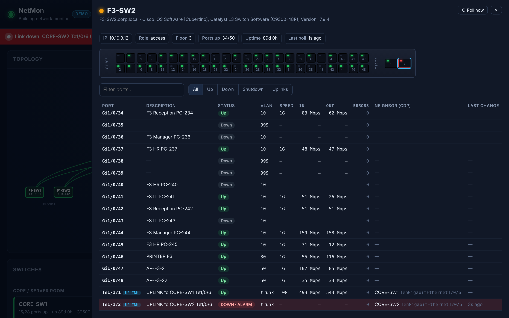

# NetMon — live network monitor for our building

A small, self-hosted monitoring system for Cisco switches:

- **Topology map**: drawn automatically from CDP. Broken links turn **red and blink**.
- **Every switch, every port**: description, up/down, VLAN/trunk, speed, live traffic, errors, CDP neighbour, last change.
- **Front-panel view** of each switch (green = up, red blinking = alarm).
- **Live alarms**: a red banner, a sound, and a counter in the browser tab, with **email** and **Microsoft Teams** messages and a recovery message when the link comes back.
- **SNMPv3** (authPriv) polling, plus **syslog** for alarms within about a second.
- Event log, alarm acknowledgement ("acknowledged by Mina"), and alarms saved across restarts.




---

## 1. Try it in demo mode (no switches needed)

```bash
git clone https://github.com/Mina914/IT-network.git netmon && cd netmon
python3 -m venv .venv
.venv/bin/pip install -r requirements.txt
.venv/bin/python -m netmon --demo
```

Open <http://localhost:8080>. The demo simulates 2 core switches and 5 floors with 2 access
switches each. Click **⚡ Simulate link failure** to see an alarm, and **🔔 Sound** to hear it.

## 2. Connect your real switches

1. **Configure the switches**: follow [docs/cisco-switch-config.md](docs/cisco-switch-config.md)
   (SNMPv3 user, syslog, CDP, descriptions).
2. **Write the config**:
   ```bash
   cp config.example.yaml config.yaml      # then edit IPs / names / floors
   ```
3. **Set the secrets** (never put keys in the YAML file):
   ```bash
   export NETMON_SNMP_AUTH='...' NETMON_SNMP_PRIV='...'
   export NETMON_SMTP_PASSWORD='...' NETMON_TEAMS_WEBHOOK='https://...'
   ```
4. **Run it**:
   ```bash
   .venv/bin/python -m netmon -c config.yaml
   ```
5. In the dashboard, check that every switch is green and the uplinks appear on the map.
   Then send a test message:
   ```bash
   curl -X POST http://localhost:8080/api/test-notify
   ```

## 3. Email and Teams

**Teams**: in the channel, open **••• → Workflows → "Post to a channel when a webhook request is
received"**, choose the team and channel, and copy the URL into `NETMON_TEAMS_WEBHOOK`. Set
`teams.enabled: true`.

**Email (Office 365)**: `smtp.office365.com`, port 587, STARTTLS, on a mailbox that has
*Authenticated SMTP* enabled (your M365 admin may need to turn it on for that mailbox). Any
internal SMTP relay also works: set `username: ""` if the relay needs no login.

## 4. When does it alarm?

| Situation | Dashboard | Email / Teams |
|---|---|---|
| Uplink or switch-to-switch link goes down | 🔴 alarm, banner, sound, red link | ✅ after `notify_delay_seconds` (default 15 s) |
| Port with description `UPLINK / SERVER / AP- / FIREWALL…` goes down | 🔴 alarm | ✅ |
| Switch stops answering SNMP (3 polls) | ⛔ alarm, switch red | ✅ |
| User PC port goes down | event log only | ❌ (set `alert_on: all` to change this) |
| Port shut down by an admin | event log only | ❌ |
| Link flaps and recovers within the delay | event log | ❌ (no spam) |
| Alarm clears | alarm removed | ✅ "RECOVERED" with the outage duration |

How the detection works: a switch sends a syslog message the moment a port changes. NetMon
raises the alarm and immediately re-polls that switch over SNMP to confirm. The regular 30 s
SNMP poll catches anything syslog missed.

## 5. Run it as a service (Ubuntu/Debian server or VM)

```bash
sudo useradd -r -s /usr/sbin/nologin netmon
sudo mkdir -p /opt/netmon /etc/netmon && sudo cp -r . /opt/netmon && cd /opt/netmon
sudo python3 -m venv .venv && sudo .venv/bin/pip install -r requirements.txt
sudo cp deploy/netmon.env.example /etc/netmon/netmon.env && sudo chmod 600 /etc/netmon/netmon.env  # edit it
sudo chown -R netmon: /opt/netmon
sudo cp deploy/netmon.service /etc/systemd/system/ && sudo systemctl enable --now netmon
journalctl -u netmon -f
```

A small VM (1 vCPU, 1 GB RAM) handles 12 switches easily. The dashboard has **no login yet**,
so only expose port 8080 to the IT/management network.

## 6. Project layout

```
netmon/
  config.py      loads config.yaml (+ ${ENV} secrets)
  snmp.py        SNMPv3 poller: IF-MIB, Cisco VLAN/trunk MIBs, CDP
  syslog.py      parses %LINK-3-UPDOWN / %LINEPROTO-5-UPDOWN for instant alarms
  monitor.py     state, topology learning, alarm rules
  notify.py      email + Teams (Adaptive Card)
  db.py          SQLite: events, alarms, learned links
  simulator.py   demo building
  app.py         web server, REST API, WebSocket live updates
  static/        dashboard (HTML/CSS/JS, vis-network bundled for offline use)
tests/           python -m pytest
docs/            Cisco config guide, screenshots
deploy/          systemd service, env file template
```

REST API: `GET /api/state`, `GET /api/devices/{name}`, `POST /api/devices/{name}/poll`,
`GET /api/events`, `GET /api/alarms?history=true`, `POST /api/alarms/{id}/ack`,
`DELETE /api/links/{id}` (remove a link from the map after re-cabling), `POST /api/test-notify`.

## 7. Ideas for next versions

- Login (local users or Active Directory/LDAP)
- Traffic graphs per port (history) and high-utilisation / error-rate alarms
- CPU, memory, temperature, PoE and power-supply / fan alarms
- MAC/ARP lookup ("which port is this PC on?")
- Nightly config backups (via SSH)
